<div align="center">

# ✈️ AviAi

### Autonomous Aviation Intelligence & Airport Simulation

**An AI-powered airport digital twin that simulates aircraft operations, coordinates arrival traffic, predicts conflicts, manages holding patterns and dynamically allocates approach clearances.**


**Current airport implementation:** Chhatrapati Shivaji Maharaj International Airport (VABB), Mumbai

</div>

---

## Table of Contents

1. [Project Overview](#1-project-overview)
2. [System Architecture](#2-system-architecture)
3. [VABB Airport Digital Twin](#3-vabb-airport-digital-twin)
4. [Arrival Route Network](#4-arrival-route-network)
5. [Holding Pattern Network](#5-holding-pattern-network)
6. [Dynamic Approach Allocation](#6-dynamic-approach-allocation)
7. [Arrival Fallback Navigation](#7-arrival-fallback-navigation)
8. [Multi-Level Holding and Fairness](#8-multi-level-holding-and-fairness)
9. [Predictive Conflict Detection and Separation](#9-predictive-conflict-detection-and-separation)
10. [Aircraft Navigation and Physics](#10-aircraft-navigation-and-physics)
11. [Hybrid AI and Deterministic Control](#11-hybrid-ai-and-deterministic-control)
12. [Test Mode and Simulation Isolation](#12-test-mode-and-simulation-isolation)
13. [Real-Time Operational Dashboard](#13-real-time-operational-dashboard)
14. [Technology Stack](#14-technology-stack)
15. [Project Structure](#15-project-structure)
16. [Installation and Setup](#16-installation-and-setup)
17. [Testing](#17-testing)
18. [Development Roadmap](#18-development-roadmap)
19. [Project Scope and Safety](#19-project-scope-and-safety)
20. [References](#20-references)
21. [Author](#21-author)

---

## 1. Project Overview

AviAi is an autonomous aviation intelligence and air traffic control simulation platform that models the operational complexity of a modern airport and its surrounding terminal airspace.

Rather than being a conventional flight tracker, AviAi creates a continuously evolving simulation in which aircraft follow configured airport routes, interact with AI-driven controllers, receive dynamic traffic instructions, enter holding patterns and progress towards approach clearance.

Increasing air traffic makes arrival sequencing, shared navigation fixes, approach allocation, holding and aircraft separation harder to coordinate. AviAi addresses this with a **hybrid architecture**: an LLM *recommends* operational actions, while deterministic navigation, physics, trajectory prediction and safety validation *decide whether they are allowed*.

### Core capabilities

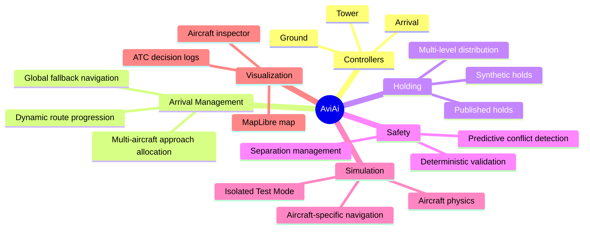

---

## 2. System Architecture

AviAi separates operational intelligence, AI recommendations, simulation execution and visualization into distinct layers.

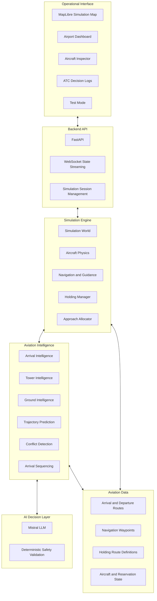

### Component responsibilities

| Component | Responsibility |
|---|---|
| **FastAPI** | Backend endpoints and operational APIs |
| **WebSockets** | Real-time aircraft and simulation state |
| **Simulation World** | Active aircraft and simulation lifecycle |
| **Aircraft Physics** | Position, velocity, heading, speed and altitude |
| **Navigation Guidance** | Waypoint progression and route following |
| **Arrival Intelligence** | Arrival sequencing and approach decisions |
| **Holding Manager** | Holding entry, circuits, release and rejoin |
| **Approach Allocator** | Approach selection and reservation ownership |
| **Conflict Detection** | Predicted traffic separation |
| **Mistral LLM** | Operational decision recommendations |
| **Safety Validator** | Validation before operational actions are committed |
| **MapLibre** | Interactive airport and airspace visualization |

---

## 3. VABB Airport Digital Twin

AviAi models the navigation environment around Mumbai Airport using structured aviation navigation data. The digital twin includes:

- Airport navigation waypoints
- Configured arrival route geometry
- Approach entry points
- Published holding fixes
- Simulation-generated (synthetic) holding fixes
- Holding racetrack geometry
- Route transitions and rejoin points
- Aircraft navigation profiles

### Operational map layers

| Layer | Content |
|---|---|
| Aircraft | Positions and callsign labels |
| Routes | Active arrival and departure routes |
| Fixes | Navigation fixes and waypoint labels |
| Approach | Approach entry markers |
| Holding | Holding pattern geometry |
| Guidance | Aircraft trails and guidance |
| Decisions | Operational decision information |
| Inspector | Aircraft-specific state inspection |

---

## 4. Arrival Route Network

The active arrival route identifiers are **001–014**. A route ID identifies an *arrival route*; it is distinct from a *holding route ID* such as `H-GUTMU` or `H-BB263-SYN`. The two must never be treated as interchangeable.

> **Note:** Route `005` is not defined in the supplied route configuration; the tables below list only configured routes.

### Route families

| Route IDs | Group | Configured holds | Downstream navigation | Approach trigger |
|---|---|---|---|---|
| 001 | Western/northern | DOBVU; synthetic BB256 | BB255 → BB256 → BB257 → BB266 | BB266 |
| 002, 003 | Western/northern | GUTMU; synthetic NM668 | NM665 → NM667 → NM668 → BB264 → BB257 → BB266 | BB266 |
| 004 | Arrival group | VELKO | BB258 → BB259 → BB257 → BB266 | BB266 |
| 006, 007, 008 | Southern/eastern | UKETU; synthetic BB252 | BB251 → BB252 → BB253 → BB254 | BB254 |
| 009 – 014 | Southern/eastern | AKTOD; synthetic BB263 | BB260 → BB261 → BB262 → BB263 → BB253 → BB254 | BB254 |

The route families share navigation structure (`BB257 → BB266` and `BB253 → BB254`), but these are *not* complete waypoint sequences. Each aircraft follows its own assigned route definition.

Holding associations come from the configured `source_routes` and `route_after_hold` values. They do **not** mean an aircraft must hold on every flight: holding is a traffic-management option, selected when needed and validated against the aircraft's route and state.

### Route topology

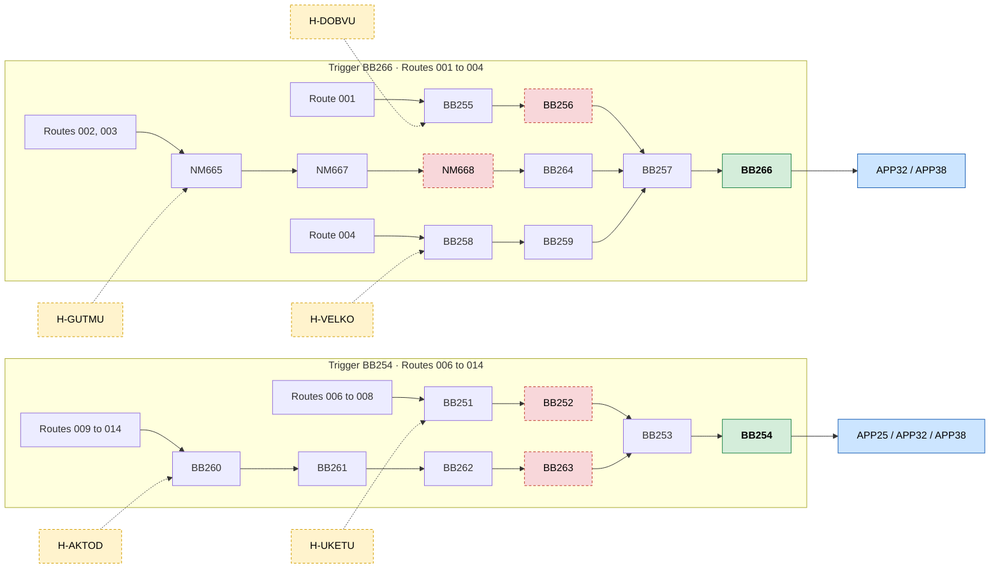

*Legend: dashed yellow = published hold rejoining the route, dashed red = fix that also hosts a synthetic hold, green = approach trigger, blue = approach entries.*

### Shared-fix traffic management

Multiple aircraft may approach the same fix from different routes (for example `BB257` and `BB253`). AviAi monitors:

- Predicted arrival times and distance to the shared fix
- Aircraft speed and heading
- Predicted horizontal and vertical separation
- Current holding and approach assignments

The system can intervene *before* aircraft reach a shared fix through speed adjustment, altitude management, holding or resequencing.

---

## 5. Holding Pattern Network

AviAi supports **five published** and **four synthetic** holding definitions for VABB, distributing arrival traffic across multiple locations instead of concentrating it at one fix.

> ⚠️ The `published` / `synthetic` flags matter. Synthetic holds are simulation-generated and are **not** presented as published real-world procedures.

### Published holding definitions

| Holding ID | Fix | Arrival routes | Turn | Leg length | Capacity | Holding levels |
|---|---|---|---|---|---:|---|
| `H-GUTMU` | GUTMU | 002, 003 | Right | 10 NM (adaptive 7 / 10 NM) | 3 | 12,000 / 14,000 / 16,000 / 18,000 ft |
| `H-DOBVU` | DOBVU | 001 | Left | 10 NM (adaptive 7 / 10 NM) | 3 | 12,000 / 14,000 / 16,000 / 18,000 ft |
| `H-VELKO` | VELKO | 004 | Left | 10 NM (adaptive 7 / 10 NM) | 3 | 12,000 / 14,000 / 16,000 / 18,000 ft |
| `H-AKTOD` | AKTOD | 009–014 | Left | 10 NM (adaptive 7 / 10 NM) | 3 | 12,000 / 14,000 / 16,000 / 18,000 ft |
| `H-UKETU` | UKETU | 006–008 | Right | 10 NM (adaptive 7 / 10 NM) | 3 | 12,000 / 14,000 / 16,000 / 18,000 ft |

Published holds use a configured **maximum holding speed of 230 kt** and a **turn radius of 3.66 NM**.

### Synthetic holding definitions

| Holding ID | Fix | Arrival routes | Turn | Leg length | Capacity | Altitude limits |
|---|---|---|---|---|---:|---|
| `H-BB263-SYN` | BB263 | 009–014 | Right | 5 NM | 2 | FL100 – FL180 |
| `H-NM668-SYN` | NM668 | 002, 003 | Right | 5 NM | 2 | FL100 – FL180 |
| `H-BB256-SYN` | BB256 | 001 | Right | 5 NM | 2 | FL100 – FL180 |
| `H-BB252-SYN` | BB252 | 006–008 | Right | 5 NM | 2 | FL100 – FL180 |

These are marked `published: false`, `synthetic: true` and `SYNTHETIC - NOT PUBLISHED`. Their geometry is for simulation only and is not an assertion that the patterns are authorized real-world procedures.

### Holding geometry and entry

Each holding definition carries:

- Fix coordinates and trigger waypoint
- Inbound magnetic and true courses (where specified)
- Turn direction, leg length and turn radius
- Maximum holding speed
- Entry fixes and entry type
- Arrival-specific entry courses
- Post-hold route and rejoin sequence
- Capacity and applicable altitude limits

Entry geometry is **not** identical for all arrivals. For example, GUTMU supports direct entries from EXOLU and IPNIB, while AKTOD has multiple arrival-specific entries and identifies SUGID as a parallel entry near a sector edge. The holding manager must use the configured entry mapping rather than assume every aircraft can enter every hold directly.

### Holding release and route rejoin

After a hold is assigned, AviAi synchronizes the holding state with navigation guidance. The aircraft follows the configured entry transition and geometry, tracks completed circuits and reassesses approach availability. The `route_after_hold` field defines the downstream sequence:

| Hold | Rejoin sequence |
|---|---|
| GUTMU | NM665 → NM667 → NM668 → BB264 → BB257 |
| DOBVU | BB255 → BB256 → BB257 |
| VELKO | BB258 → BB259 → BB257 |
| AKTOD | BB260 → BB261 → BB262 → BB263 → BB253 → BB254 |
| UKETU | BB251 → BB252 → BB253 → BB254 |

Synthetic patterns use their own shorter route extensions from the holding configuration.

> A release is not valid merely because the AI recommends it. The route must be restored, the rejoin node must be valid, and any approach clearance must be committed through the normal validation path.

The holding manager handles: fix selection, route selection, aircraft-specific entry transitions, altitude assignment, turn direction and geometry, circuit tracking, rejoin node assignment and route restoration after release.

---

## 6. Dynamic Approach Allocation

AviAi has three configured approach entries:

| Approach entry | Configured altitude |
|---|---:|
| APP25 | 5,000 ft |
| APP32 | 6,000 ft |
| APP38 | 7,000 ft |

### Compatibility

| Route trigger | Approach entries evaluated |
|---|---|
| BB254 | APP25, APP32, APP38 |
| BB266 | APP32, APP38 |

The allocator evaluates compatibility and traffic conditions before committing clearance. It considers existing reservations, previously committed assignments, route and entry compatibility, aircraft altitude and speed, ETA and sequencing, predicted separation, and approach geometry and reachability.

### Vertical profile: holding levels to approach entries

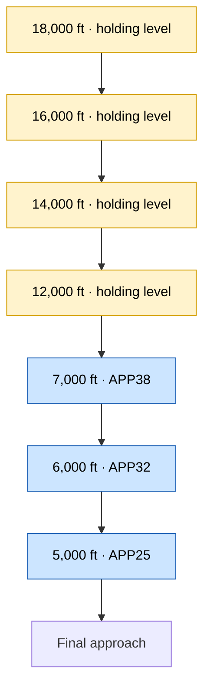

*Published holds offer 12,000 to 18,000 ft levels; synthetic holds span FL100 to FL180. These are candidate levels, not fixed assignments.*

### Allocation lifecycle

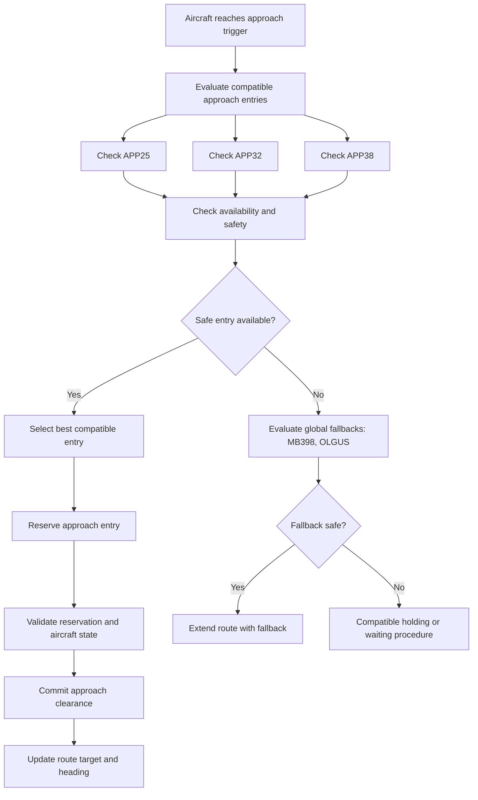

### Preference order at route end

1. Find a compatible approach entry that passes safety checks.
2. Reserve and commit it, and update navigation targets.
3. If none is safe, evaluate global fallbacks **MB398** and **OLGUS**.
4. If no fallback is safe, evaluate a compatible holding or waiting procedure.

A safe approach entry always takes priority over fallback navigation.

### Reservation ownership and recovery

Reservations must stay consistent with actual aircraft state. A cleared aircraft in `FINAL` targeting a configured approach entry **counts as occupying that entry even if its reservation record is missing or needs recovery**, preventing the same entry being assigned twice. At route end the allocator invokes the normal dynamic selection logic rather than waiting indefinitely for an earlier reservation.

---

## 7. Arrival Fallback Navigation

When no compatible approach entry can be safely allocated, AviAi uses global fallback candidates:

- **MB398**
- **OLGUS**

Fallback points need not appear in the aircraft's original STAR, but must exist in navigation data and pass reachability, turn-geometry and traffic-separation checks. **DOGAP is explicitly excluded.**

The system evaluates navigation data availability, aircraft position and reachability, inbound heading, turn geometry, route compatibility, predicted traffic separation and other aircraft trajectories. Once a candidate is chosen, AviAi appends the required waypoint and trigger to the active route (without repeatedly appending the same extension) and synchronizes the navigation cursor, assigned waypoint and guidance target so the aircraft keeps progressing instead of re-targeting a captured waypoint.

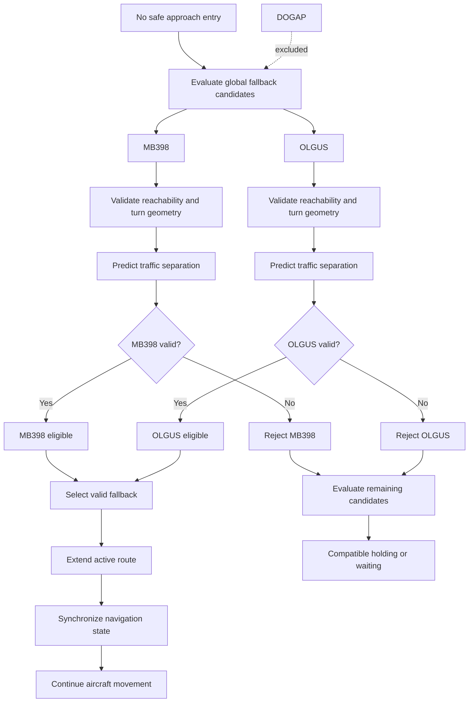

The mechanism is meant to prevent route-end loops while preserving the priority of safe approach clearance.

---

## 8. Multi-Level Holding and Fairness

As traffic density rises, AviAi distributes suitable aircraft across compatible holding fixes and altitude levels instead of stacking everything at one location.

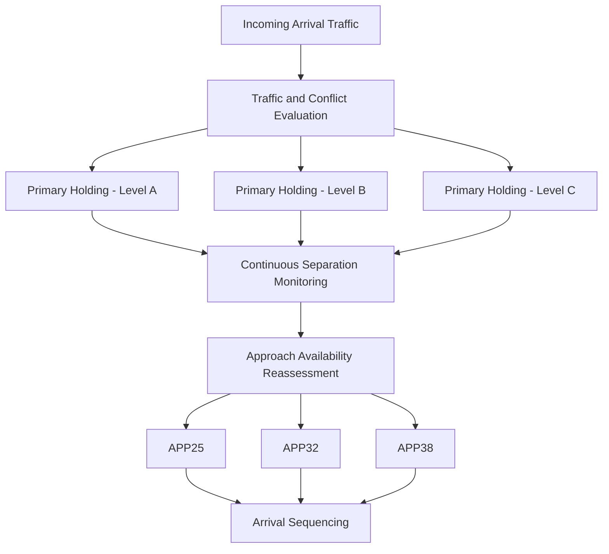

*Conceptual allocation only, not fixed altitude assignments.*

### Holding candidate evaluation

A holding assignment considers current and target altitude, position, inbound heading, distance to the fix, route compatibility, entry transition, turn geometry, speed, predicted horizontal separation, required vertical separation, existing holding assignments and downstream approach traffic.

Higher altitude can make an aircraft a *suitable candidate*, but **altitude alone never authorizes a holding assignment.**

### Holding circuit lifecycle

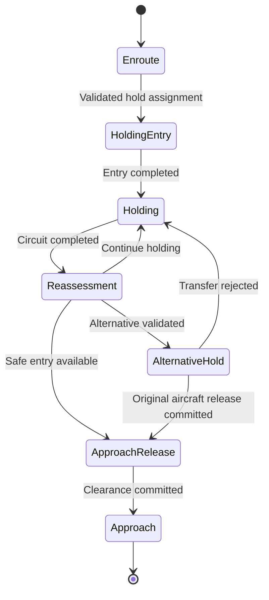

### Holding fairness roadmap *(planned)*

| Completed circuits | Planned policy |
|---|---|
| 1 | Reassess available approach entries |
| 2 | Increase release priority |
| 3 | High-priority release and alternative-holding evaluation |
| 4 | Maximum planned holding duration; escalate if safety prevents release |

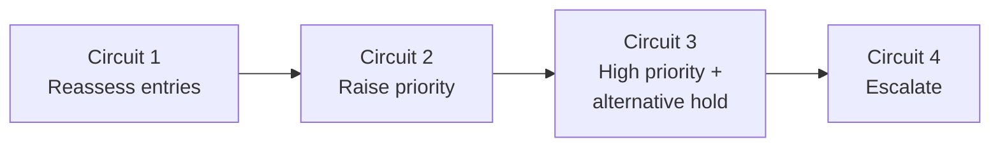

- The count must reflect **completed circuits**, not reassessment requests or holding-entry transitions.
- Circuit limits **never override separation**. If a release would create an unsafe conflict, the system keeps evaluating safe alternatives and records why release was rejected.

---

## 9. Predictive Conflict Detection and Separation

AviAi predicts conflicts by analysing trajectories and expected positions at shared navigation fixes and approach merges. It considers shared route fixes, predicted arrival times, distance to target waypoint, heading and speed, horizontal and vertical separation, approach entry occupancy, holding assignments, and speed/altitude interventions.

### Conflict-resolution lifecycle

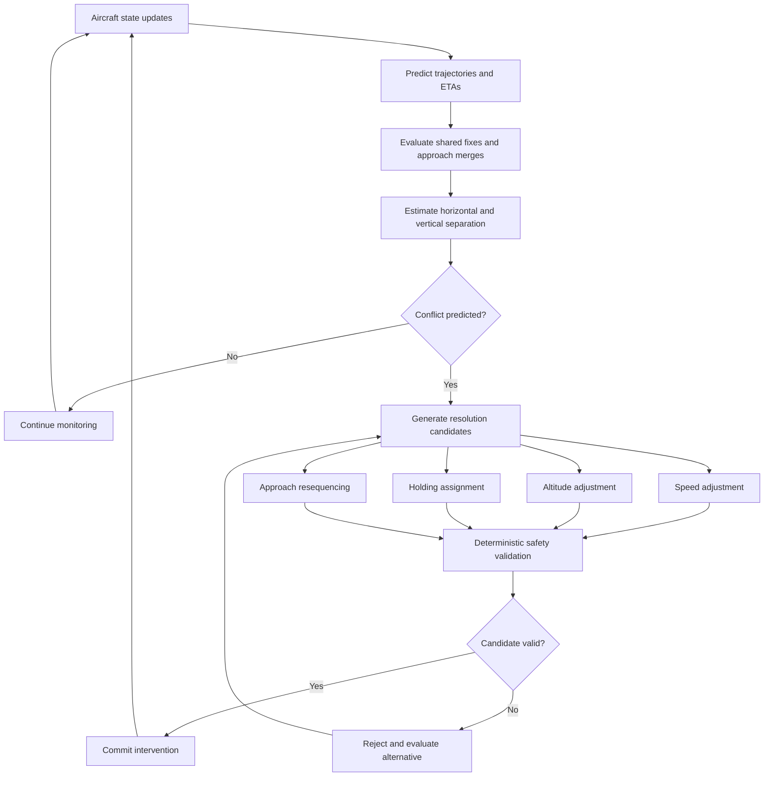

### Horizontal separation

AviAi uses a **6 NM** horizontal separation requirement as a conservative *project configuration*. It is not a universal real-world ATC minimum.

| Source | Horizontal minimum |
|---|---|
| **AviAi (configured)** | **6 NM** |
| AAI eAIP ENR 1.6, surveillance-based, general | 5 NM |
| AAI eAIP ENR 1.6, authorized within 40 NM of Mumbai ASR/MSSR head, at or below FL140 | 3 NM |

Actual application of real-world minima depends on airspace, authorization, surveillance conditions and operational rules. AviAi does not claim to reproduce them.

### Vertical separation

| Condition (Indian ATS guidance, for reference) | Nominal vertical separation |
|---|---|
| Below FL290 | 1,000 ft |
| At or above FL290 | 2,000 ft (unless RVSM provisions apply) |
| Designated RVSM airspace, qualifying aircraft | 1,000 ft |

The simulation's configured minimums and holding levels are implementation choices. They should be checked against the actual validation logic and not assumed to implement every real-world exception, aircraft approval requirement or airspace-specific procedure.

The system does **not** assume that different holding fixes automatically guarantee safe separation.

---

## 10. Aircraft Navigation and Physics

The engine moves aircraft through a closed-loop navigation and physics system covering waypoint progression and capture, heading guidance, turn transitions, speed and altitude control, vertical movement, holding navigation, approach transitions, route restoration after holding, and navigation cursor synchronization.

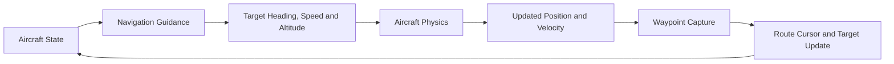

The system keeps the **active route, assigned waypoint, target node, heading and clearance state** synchronized. This matters most during holding activation, holding release and fallback route extension.

---

## 11. Hybrid AI and Deterministic Control

The LLM **recommends**; deterministic components **validate and execute**.

| AI responsibilities (Mistral) | Deterministic responsibilities |
|---|---|
| HOLD / RELEASE | Aircraft identity and session |
| Approach sequencing | Current route and navigation state |
| Holding assignments | Approach entry compatibility |
| Speed interventions | Reservation ownership |
| Altitude interventions | Holding route compatibility |
| Traffic management actions | Entry and rejoin geometry |
| | Predicted traffic separation |
| | Clearance state |
| | Whether the decision is still valid |

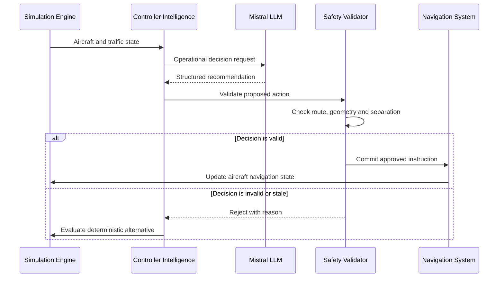

**Malformed, delayed or unavailable AI responses must never bypass deterministic safety validation.** Simulation-session identifiers also scope controller decisions so stale or cross-session decisions cannot affect the wrong aircraft.

---

## 12. Test Mode and Simulation Isolation

An isolated Test Mode supports controlled traffic experiments. Users select eligible arrival nodes on the map and spawn test aircraft with compatible route and navigation configurations.

**Capabilities:** direct arrival-node selection, automatic test aircraft, unique test callsigns, multiple simultaneous aircraft, individual removal, live route progression, and testing of approach allocation, holding, conflict detection and separation management, followed by restoration of the normal simulation.

Test Mode uses **the same engine and intelligence logic** as the normal simulation, with no simplified or separate ATC implementation.

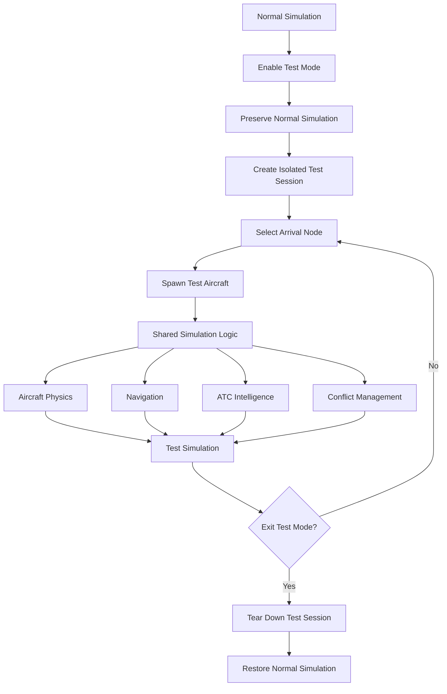

> A successful API spawn alone does not prove an aircraft progressed correctly. During scenario verification, check the **route cursor, target waypoint, holding state, clearance and decision-commit events**.

---

## 13. Real-Time Operational Dashboard

The frontend uses MapLibre to visualize the simulation. Aircraft markers persist across updates, and the interface supports aircraft inspection, navigation visualization and operational monitoring.

| Information | Description |
|---|---|
| Aircraft callsign | Unique aircraft identification |
| Aircraft type | Simulated aircraft profile |
| Position | Current geographic position |
| Heading | Current and target heading |
| Altitude | Current and target altitude |
| Speed | Current and target speed |
| Vertical speed | Climb or descent rate |
| Target node | Active navigation target |
| Holding state | Holding fix, route and circuit count |
| Approach state | Arrival phase and clearance |
| ATC instruction | Latest operational instruction |
| Decision logs | Controller decisions and validation events |

---

## 14. Technology Stack

| Layer | Technologies |
|---|---|
| Backend | Python, FastAPI |
| Frontend | HTML, CSS, JavaScript |
| Interactive maps | MapLibre |
| Real-time communication | WebSockets |
| AI decision-making | Mistral LLM |
| Simulation | Custom Python aircraft simulation engine |
| Navigation | Configured routes and waypoint geometry |
| State management | Redis and in-memory simulation state |
| Data processing | Python, NumPy, JSON |
| Testing | Pytest and JavaScript test suites |

---

## 15. Project Structure

```text
AviAi/
│
├── app/
│   ├── api/
│   │   └── simulation.py
│   │
│   ├── intelligence/
│   │   ├── approach_ai.py
│   │   ├── guidance_ai.py
│   │   ├── fallback_selection.py
│   │   ├── trajectory.py
│   │   ├── behavior.py
│   │   ├── event_engine.py
│   │   └── mistral/
│   │
│   ├── navigation/
│   │   └── routes/
│   │
│   ├── simulation/
│   │   ├── engine.py
│   │   ├── world.py
│   │   └── holding_manager.py
│   │
│   └── parser/
│
├── data/
│   └── navigation/
│       └── VABB/
│
├── frontend/
├── static/
├── tests/
├── holding_routes.json
├── requirements.txt
└── README.md
```

---

## 16. Installation and Setup

**1. Clone the repository**

```bash
git clone https://github.com/SK25397938/AviAi.git
cd AviAi
```

**2. Create a virtual environment**

```bash
python -m venv venv
```

Windows:

```bash
venv\Scripts\activate
```

macOS / Linux:

```bash
source venv/bin/activate
```

**3. Install dependencies**

```bash
pip install -r requirements.txt
```

**4. Configure environment variables**

Create a `.env` file in the project root:

```env
MISTRAL_API_KEY=your_mistral_api_key
```

Configure Redis and any other services according to your environment.

**5. Start the backend**

```bash
uvicorn app.main:app --reload
```

Default development address: `http://127.0.0.1:8000`. Use the configured entry point and port if your setup differs.

**6. Launch the frontend**

Start the frontend with the project's configured development server, or serve its static files according to the existing frontend setup.

---

## 17. Testing

Regression tests cover simulation, navigation and intelligence components:

- Approach entry allocation and reservation ownership
- Recovery of committed approach reservations
- Route-end approach allocation
- Global fallback selection, reachability and geometry
- DOGAP fallback exclusion
- Duplicate route-extension prevention
- Holding route compatibility, lifecycle and release validation
- Route progression
- Test Mode isolation
- Simulation state management

```bash
pytest tests/
```

Report results against your actual local test run. Passing tests are **not** proof of certified real-world ATC performance.

---

## 18. Development Roadmap

```mermaid
flowchart LR
    subgraph H["Holding management"]
        H1["Progressive circuit limits"]
        H2["Holding-time fairness"]
        H3["Alternative hold evaluation"]
        H4["Better delay distribution"]
    end
    subgraph A["Arrival management"]
        A1["Advanced multi-aircraft sequencing"]
        A2["Approach allocation at high density"]
        A3["Enhanced conflict resolution"]
        A4["Traffic-flow optimization"]
    end
    subgraph O["Airport operations"]
        O1["Tower and Ground autonomy"]
        O2["Airport surface movement"]
        O3["Runway and taxiway logic"]
    end
    subgraph S["Simulation and analytics"]
        S1["Traffic performance metrics"]
        S2["Decision analytics"]
        S3["Additional airport twins"]
        S4["Multi-aircraft stress testing"]
    end
    H --> A --> O --> S
```

---

## 19. Project Scope and Safety

AviAi is an **experimental aviation simulation and research platform** for software development, simulation and exploration of AI-assisted aviation operations.

It is **not a certified air traffic control system** and must **not** be used to issue real-world ATC instructions or replace qualified aviation personnel.

Published navigation data and simulation-generated geometry must remain clearly distinguished. Synthetic holding patterns are for simulation purposes and do not represent authorized real-world procedures.

---

## 20. References

These are reference material for the design rationale only:

- Airports Authority of India, [eAIP ENR 1.6: ATS Surveillance Services and Procedures](https://aim-india.aai.gov.in/eaip/eaip-v2-03-2026/eAIP/IN-ENR%201.6-en-GB.html)
- Airports Authority of India, [eAIP ENR 1.9: Additional Rules and Procedures (RVSM)](https://aim-india.aai.gov.in/eaip-v2-02-2024/eAIP/IN-ENR%201.9-en-GB.html)
- Airports Authority of India, [Manual of Air Traffic Services, Part 1](https://aim-india.aai.aero/sites/default/files/ais_docs/Manual%20of%20Air%20Traffic%20Services%2C%20Part-1%20Edition%206.2.pdf)

---

## 21. Author

**Subodh Koli**
B.Tech, Artificial Intelligence & Data Science, SIES Graduate School of Technology

Interests: AI Engineering, Autonomous Systems, Aviation Intelligence, Simulation Architecture, Predictive Analytics and Applied Machine Learning.

[GitHub](https://github.com/SK25397938) · [LinkedIn](https://linkedin.com/in/subodh-koli-9266a237a/)

---

## Vision

AviAi explores how autonomous intelligence, predictive analytics and digital twins can transform the simulation and coordination of complex airport operations: from individual aircraft navigation to multi-aircraft arrival sequencing, predictive separation and multi-level holding allocation, building an environment where traffic is continuously evaluated, intelligently coordinated and safely managed.
